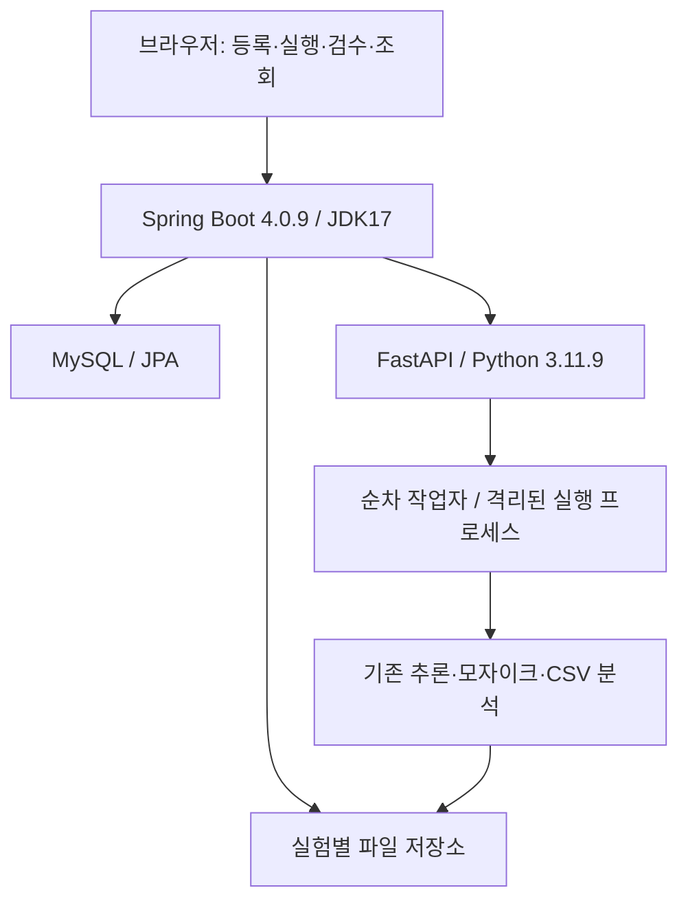

# 구현 아키텍처

## 역할

브라우저는 Spring Boot에만 접속한다. Spring MVC + Thymeleaf가 화면을 제공하고, 같은 출처의 JavaScript가 Spring REST API를 호출한다. Spring Data JPA가 MySQL을 관리한다. Python은 내부 API 키를 확인하고 순차 작업 대기열을 운영하며 DB에 접근하지 않는다.

## 통신 사례

1. `POST /api/runs`: 사진·정답 스냅샷과 실험 행, 작업 행 생성.
2. `JobPoller`: `POST Python /jobs`로 작업 ID·실험 ID·종류·설정·개정 번호 전달.
3. Python은 202를 즉시 반환. 같은 작업 ID는 같은 상태를 반환한다.
4. Python 단일 작업자가 `runner.py` 자식 프로세스를 실행한다. 이 프로세스만 원본 모듈의 전역 경로를 작업 폴더로 연결한다.
5. Spring은 `GET Python /jobs/{id}`로 상태·진행률을 조회한다. 로그는 작업 ID별 파일로 보존한다.
6. Python이 보고서를 새 폴더로 원자적으로 이동하고 결과 경로를 완료 상태에 기록한다.
7. Spring이 파일 해시·크기·실험 ID·사진/정책/정답·행 수를 검사한다.
8. `ReportImporter.accept()`의 트랜잭션으로 결과·후보·얼굴·보고서·산출물을 저장한다.
9. DB 반영이 성공해야 실험과 작업이 `COMPLETED`가 된다.

## 계획 대비 구현 선택

- 모델 상주 방식 대신 **실험당 프로세스 한 개**를 사용한다. 기존 세 프로그램의 전역 설정과 경로를 격리하고, 실패·시간 제한을 제어하기 위한 선택이다. 한 실험의 4정책에는 동일 YOLO/Haar 검출 후보를 재사용한다.
- 데이터셋과 데이터셋 버전을 별도 두 테이블로 나누지 않고, `dataset` 한 행을 확정 버전으로 사용한다. `parent_id`로 수정 전 버전을 연결한다.
- 후보·얼굴 좌표는 각각 관계 테이블에 저장하되 원본 CSV 행 전체를 JSON으로 보존한다. 원본 컬럼 손실을 피하고 학생 프로젝트의 마이그레이션을 단순화한다.
- 별도 메시지 브로커는 사용하지 않는다. DB 작업 상태, Python 상태 JSON, 작업 로그, 완료 매니페스트로 재시작·재수집을 지원한다.
- 검증 결과는 `docs/VALIDATION.md`에서 실제와 미확인을 구분한다. PDCA 완료를 가정했다는 이유로 검증 결과를 만들어 쓰지 않는다.

## 저장 구조

- `storage/datasets/{id}/data`: 확정 사진·정답.
- `storage/runs/{id}/data`: 실행 입력 스냅샷.
- `storage/runs/{id}/work`: 원본 추론 결과. 재분석에서 변경하지 않음.
- `storage/runs/{id}/analysis-{작업ID}`: 재분석 작업 공간.
- `storage/runs/{id}/review_inputs/{작업ID}`: 검수 CSV와 시점 스냅샷.
- `storage/runs/{id}/reports/r0001`: 이미지·CSV·정답 입력·환경/해시·매니페스트.
- `storage/runs/{id}/logs`: 작업별 stdout/stderr.
- `storage/jobs/{작업ID}.json`: Python 작업 상태.

## 오류 복구

|상황|동작|
|---|---|
|일시적 Python 연결 실패|작업을 유지하고 다시 조회. 최근 오류 표시|
|추론 시간 초과|해당 작업 프로세스 종료, 실패 상태·로그 유지|
|Python 재시작|미완료 작업을 중단 실패로 기록|
|Spring 재시작|DB의 QUEUED/RUNNING 작업을 다시 전달·조회|
|Python 완료 후 DB 오류|IMPORT_FAILED. 기존 파일 재수집 가능|
|분석 재생성 실패|기존 완료 보고서 유지, 실패 작업 기록|
|새 실험 실패|이전 실험 파일·DB 기록은 그대로 유지|

## 설정 범위

현재 웹의 숫자 설정 변경은 4정책 실험에만 적용한다. MIN_FACE_SIZE, YOLO_CONFIDENCE, YOLO_IMAGE_SIZE, MOSAIC_SIZE, FACE_PADDING_RATIO를 허용 범위로 제한한다. 기존 함수가 기본 인자에 잡아둔 경로·모자이크 크기·여백도 어댑터에서 명시적으로 전달한다. 초기·기준 프로그램의 알고리즘과 고정 설정은 원본을 유지한다.

## 버전 근거

Spring Boot 4.0.9, Gradle 8.14.3, Java17을 고정한다. Boot4의 Web MVC·Flyway 모듈에 맞는 starter를 사용하고 JSON 처리는 기본 Jackson3를 사용한다.

- https://docs.spring.io/spring-boot/4.0/system-requirements.html
- https://docs.spring.io/spring-boot/4.0/appendix/auto-configuration-classes/spring-boot-flyway.html
- https://docs.spring.io/spring-boot/4.0/how-to/spring-mvc.html
