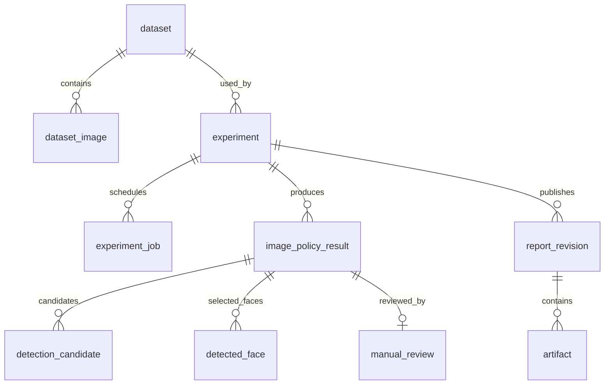

# 구현 관계도

`dataset` 한 행을 확정 데이터셋 버전으로 사용한다. `parent_id`는 수정 전 데이터셋을 가리킨다. 세부 컬럼은 TABLES.md와 Flyway SQL을 기준으로 한다.

- 사진·정책 결과는 `(run_id, filename, policy)`가 유일하다.
- 보고서는 `(run_id, revision)`이 유일하다.
- 후보·얼굴은 결과 ID와 연결하고 원본 행의 JSON payload를 보존한다.
- 수동 검수는 결과 하나당 현재 기록 하나를 보유한다. 보고서 생성 시 입력 CSV와 시점 정보를 별도로 고정한다.
- 파일을 자동 삭제하는 기능은 없으며 부모 행의 연쇄 삭제도 제공하지 않는다.
