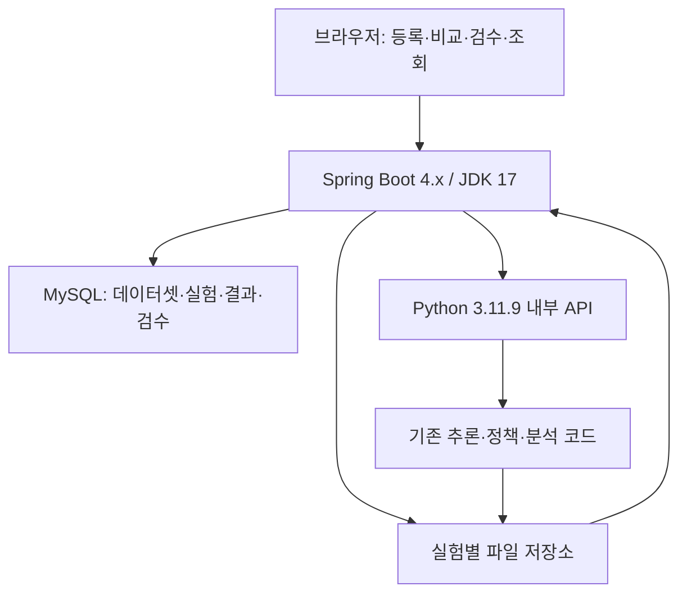

# DeepSight v2.1 → Spring Boot 4.x 웹서비스 전환 작업계획서

- 작성일: 2026-11-07
- 작업 방식: ChatGPT Work에서 단계별 산출물 검토 및 승인 후 진행
- 현재 단계: **P(계획), 사용자 검토용 초안 v1.0**
- 분석 대상: 첨부 `pjt_DeepSight_v2.1.zip`
- 지정 환경: JDK 17 / Gradle / Python 3.11.9 / MySQL
- 이번 작업: 첨부 소스·문서·CSV 구조 확인과 계획서 작성. **애플리케이션 코드 수정·생성, 서버 실행, DB 생성·변경은 수행하지 않음.**

## 1. 목표와 완료 기준

기존의 사진 준비 → 정답표 작성 → 이전 결과 보존 → 실험 실행 → 4정책 비교 → 오차 분석 → 수동 검수 → 기록 보관 과정을 브라우저에서 수행한다. 사용자는 폴더와 CSV를 직접 찾아다니지 않고 사진, 실험, 정책, 검수 상태를 기준으로 결과를 조회한다.

Spring Boot는 화면, 입력 검증, 실험 진행 관리, DB 저장·조회와 파일 제공을 담당한다. Python은 기존 얼굴 검출·모자이크·정책 비교·CSV 검증·보고서 생성을 재사용한다. 검출 알고리즘을 Java로 다시 작성하지 않는다.

최종 완료 기준은 다음과 같다.

1. 브라우저에서 사진 여러 장과 정답표를 등록하고 4정책 실험을 시작한다.
2. 이전 실험 설명·보존 확인과 새 실험 목적을 화면에서 기록한다.
3. 처리 중에는 진행 상태를 확인하고, 완료 후 원본과 정책별 결과 이미지를 조회한다.
4. 정답과 예측, 과다·과소 검출, 처리 실패, 검수 필요 여부를 구분한다.
5. 수동 검수를 저장하고 검수 정보를 반영한 보고서를 다시 생성한다.
6. 서버를 다시 시작해도 완료한 실험과 이미지·검수·CSV를 다시 조회한다.
7. 동일 조건으로 새로 실행한 기존 Python 결과와 웹 결과를 비교해 전환으로 인한 차이를 확인한다.

## 2. 현재 프로젝트 진단

### 2.1 확인 수준

아래 내용은 첨부 소스와 동봉 문서·CSV를 읽어 확인한 결과다. 이번 계획 단계에서는 모델 추론, 자동 테스트, Windows 환경 재현을 실행하지 않았다. 동봉 README의 기존 검증 기록은 과거 기록이며 이번 실행 검증 결과로 취급하지 않는다.

### 2.2 실제 구성과 웹 전환 대응

| 현재 구성 | 확인한 역할·출력 | 웹서비스 대응 |
|---|---|---|
| `data/images/` | 기준 사진 20장 | 데이터셋 사진 등록·갤러리 |
| `data/ground_truth.csv` | `파일명`, `실제 얼굴 수`, `scene`, `note` | 정답표 업로드·편집·버전 관리 |
| `source/main.py` | 초기 Haar 시험, `outputs/first/` | 초기 기준 결과 별도 조회·필요 시 재현 |
| `source/main_1_baseline.py` | 이전 YOLO+Haar 기준 시험, `outputs/second-baseline/` | 기준 버전 결과 별도 조회·필요 시 재현 |
| `source/main_1.py` | 얼굴 검출·모자이크·4정책 실행 | Python 추론 핵심 재사용 |
| `scripts/run_experiment.py --compare` | 공식 진입점, 이전 결과 백업·주석·추론·분석·실패 시 복원 시도 | 웹 실험 실행 절차의 기준 |
| `scripts/build_deepsight_reports.py` | CSV 일관성 검증, 오차 분석, 정책별·종합 보고서 | Python 분석 작업으로 재사용 |
| `reviews/manual_review.csv` | 실험·정책·파일명 단위 수동 검수 입력 | 웹 검수 저장 및 호환 CSV 출력 |
| `csv_backup/` | 이전 실험 파일과 설명·설정·해시 보존 | 기존 백업 가져오기 및 웹 실험 이력·보존 관리 |
| `outputs/experiments/{policy}/` | 정책별 결과 이미지와 CSV | 실험별 결과 상세·다운로드 |
| `outputs/experiment_run.json` | 공식 실행 성공 시 실험 ID·설정·입력 해시 등 기록 | 실험 재현 정보 관리 |

`main.py`와 `main_1_baseline.py`는 4정책 비교의 직접 입력이 아니다. 화면에서 ‘초기/기준 버전’과 ‘현재 4정책 실험’을 구분한다. `legacy` 정책을 초기 `main.py`와 같은 것으로 표시하지 않는다.

### 2.3 유지할 핵심 흐름

1. 원본 사진과 수기 정답을 준비한다.
2. 기존 결과가 있으면 보존 여부를 확인하고 이전 실험 설명을 기록한다.
3. 기존 결과 백업의 파일 수와 SHA-256을 확인한다. 검증 실패 시 새 실행을 막는다.
4. 새 실험 목적·변경사항을 입력한다.
5. 필수 입력·모델 존재 여부를 확인한다.
6. 동일 사진의 YOLO·Haar 검출 결과를 활용해 `legacy`, `yolo_only`, `haar_only`, `improved`를 비교한다.
7. 정책별 추론 CSV와 모자이크 이미지를 만든다.
8. 분석기가 상태·검출 수·좌표·후보 일관성을 검사하고 종합 보고서를 만든다.
9. 성공 시 실험 정보를 기록한다. 실패 시 이전 정상 결과를 유지하거나 복원하고 실패 기록을 남긴다.
10. 수동 검수 내용을 해당 실험에 연결하고 필요하면 분석만 다시 수행한다.

### 2.4 전환 시 해결할 제약

| 현재 제약 | 계획 |
|---|---|
| 공식 실행에서 `input()`으로 백업 동의·주석 입력 | 웹 입력을 받는 비대화식 작업 인터페이스로 분리. 터미널 입력을 기다리는 프로세스를 웹에서 그대로 실행하지 않음 |
| 경로와 설정값 일부가 전역 상수 | 입력·정답표·모델·출력 경로와 설정을 작업 단위로 전달하도록 어댑터 구성 |
| `run()`은 입력·출력 인자를 받지만 정답 읽기는 전역 `GT_PATH` 사용 | 데이터셋에 맞는 정답 경로까지 명시적으로 주입. 사진 1장 시험 시 그 사진의 정답만 사용 |
| 공통 `outputs/`를 갱신 | 실험별 저장 공간을 분리해 덮어쓰기·동시 실행 충돌 방지 |
| 정책별 파일명·CSV를 직접 찾아야 함 | 이미지·실험·정책·상태 필터와 상세 화면 제공 |
| 기존 CSV에 실험 당시 설정·ID가 없을 수 있음 | ‘가져온 과거 자료 / 설정 미확인’으로 표시. 현재 설정을 과거 자료에 소급 적용하지 않음 |
| 현재 코드는 사진 중심 | 웹캠·동영상은 별도 확장 승인 대상으로 분리 |
| requirements가 다수 패키지 전체 고정 목록 | Python 3.11.9의 별도 가상환경에서 설치 가능성과 필수 의존성을 검증한 후 호환 버전 고정 |

ZIP에는 `yolov8n-face-lindevs.pt`와 Haar XML이 들어 있다. 다만 `main_1.py`의 Haar 로더는 `cv2.data.haarcascades`의 정면·측면 XML을 사용한다. 재현 정보에는 실제 사용한 파일을 기록해야 한다.

첨부 CSV의 개수 일치율은 legacy 75%, yolo_only 95%, haar_only 50%, improved 85%다. README는 사용자 PC의 이후 실행 결과가 이 ZIP에 포함되지 않았다고 명시한다. 이 숫자를 최신 성능 또는 웹 전환 합격 목표로 사용하지 않는다.

## 3. 제안 아키텍처

### 3.1 기술 구성

| 구분 | 계획 | 선택 이유 |
|---|---|---|
| Java | JDK 17 | 사용자 지정 유지 |
| 웹 서버 | Spring Boot 4.x, Spring MVC | 화면·서비스·DB 처리를 한 프로젝트에서 관리 |
| 빌드 | Gradle Wrapper, 8.14 이상 호환 버전 | PC별 Gradle 설치 차이 축소 |
| 화면 | Thymeleaf + HTML/CSS + 최소 JavaScript | 학생이 구조를 이해하고 수정하기 쉬운 구성 |
| DB 접근 | Spring Data JPA / MySQL Connector | Spring Boot에서 데이터 저장·조회 담당 |
| DB | MySQL, `utf8mb4` | 이미지 정보·실험·검수·오차 분석 조회 |
| Python | 3.11.9, 전용 `.venv` | 기존 추론 자산 재사용 |
| Python 연동 | FastAPI + Uvicorn의 내부 HTTP API | 상주 모델, 작업 상태 조회, Spring/Python 역할 분리 |
| 추론 | 기존 YOLO 얼굴 모델·OpenCV Haar·정책 로직 | 모델·알고리즘 변경과 웹 전환 효과를 분리해서 검증 |
| 파일 | 서버의 실험별 파일 저장 공간 | 원본·모자이크·CSV·모델을 파일로 보관하고 DB에 경로·해시 저장 |
| 기본 운영 | 같은 Windows PC, CPU 우선 | 교실 환경에서 검증 가능하도록 범위 제한 |

Spring Boot 4.0 공식 시스템 요구사항은 Java 17 이상과 Gradle 8.14 이상(8.x) 또는 9.x를 안내한다. 따라서 지정 조합은 가능하다. 구체적인 Spring Boot 4.x 안정 패치·Gradle·MySQL 버전은 D0에서 호환성을 확인하고 고정하며 SNAPSHOT은 사용하지 않는다.

공식 근거: https://docs.spring.io/spring-boot/4.0/system-requirements.html

### 3.2 구성도

브라우저는 Spring Boot에만 요청한다. Python은 기본적으로 `127.0.0.1`의 내부 포트에서 실행하며 DB를 직접 수정하지 않는다. 모델은 Python이 읽고, 이미지·CSV는 허용된 작업 폴더에서만 처리한다.

### 3.3 Spring Boot → Python 작업 흐름

1. Spring Boot가 사진·정답표를 검증하고 데이터셋 버전을 확정한다.
2. 사용자가 이전 결과 보존과 실험 목적을 확인한다.
3. Spring Boot가 실험 ID를 발급하고 DB에 `QUEUED` 상태를 저장한다.
4. 작업 폴더에 원본·정답·검수 입력·설정의 스냅샷을 준비한다.
5. Python API에 실험 ID, 작업 종류, 승인된 설정, 서버가 발급한 작업 경로를 전달한다.
6. Python은 작업 ID를 즉시 반환하고 내부 작업자가 추론·분석을 실행한다. 브라우저 요청을 전체 추론 시간 동안 붙잡지 않는다.
7. Spring Boot가 Python 상태를 주기적으로 조회해 진행률과 오류를 DB·화면에 반영한다.
8. Python이 완료 매니페스트, 결과 경로·해시·CSV 정보를 반환한다.
9. Spring Boot가 파일·행 수·정책·검증 결과를 확인하고 DB에 결과를 트랜잭션으로 반영한다.
10. 파일·DB 반영을 모두 마친 경우에만 완료·조회 가능한 실험으로 게시한다.

상태는 `QUEUED → RUNNING → VALIDATING → IMPORTING → COMPLETED`를 기본으로 한다. 어느 단계에서든 실패하면 단계·원인과 함께 `FAILED`로 기록한다. ‘처리 성공’과 ‘얼굴 개수 일치’를 별도 항목으로 표시한다.

초기에는 CPU 작업자 1개가 실험을 순차 처리한다. 여러 사용자가 등록·조회할 수 있지만 추론은 대기열에서 순서대로 진행한다. 메시지 브로커 등 별도 분산 시스템은 초기 구성에 넣지 않는다.

### 3.4 기존 보존 절차를 웹에 적용하는 방식

- 기존 CLI 명령과 원본 프로젝트는 별도로 보존한다.
- 웹은 새 실험 ID마다 별도 폴더를 사용하고 완료한 실험의 원본·추론 결과를 덮어쓰지 않는다.
- 기존 ‘백업하시겠습니까?’ 단계는 이전 실험 보존 상태·파일 수·해시 확인과 이전 실험 설명 입력으로 제공한다. 확인을 취소하면 새 실행을 시작하지 않는다.
- 최초 기존 프로젝트 결과를 가져올 때는 별도 스냅샷을 만들고 해시를 확인한다. `first/`, `second-baseline/`는 기존 공식 백업 대상과 구분해 별도 과거 자료로 등록한다.
- 새 작업이 실패해도 이전 완료 실험은 계속 조회한다. ‘최근 정상 결과’ 연결은 새 실험이 최종 완료된 뒤에만 바꾼다.
- 수동 검수·분석 재생성은 보고서 개정 번호를 부여한다. 이전 보고서도 보관한다.
- 한 PC 안의 이력 보존은 장비 고장에 대비하는 백업과 다르다. 운영 인계 시 DB와 파일의 일관된 외부 백업·복원 절차도 마련한다.

이 방식은 기존의 ‘이전 결과 보존 후 새 실행’ 목적을 유지하면서 웹의 여러 실험을 안전하게 조회하기 위한 변경안이다.

## 4. 화면과 기능 범위

### 4.1 1차 필수 기능

| 화면 | 주요 기능 | 확인할 결과 |
|---|---|---|
| 시작 화면 | 최근 실험, 처리 상태, 검수 대기, 새 실험 버튼 | 다음 작업 위치를 쉽게 찾음 |
| 데이터셋 관리 | 여러 사진 업로드, 썸네일, 원본 보기, 파일명·해상도 확인 | 사진 20장과 정답 연결 |
| 정답표 관리 | CSV 가져오기·내보내기, 실제 얼굴 수·장면·비고 편집 | 누락·중복·음수·사진 불일치 검증 |
| 실험 준비 | 데이터셋 버전, 실험 목적·변경사항, 이전 결과 보존 확인 | 실행 전 조건 검토 |
| 실험 진행 | 대기·처리·검증·저장 단계와 완료 건수, 오류 표시 | 긴 작업의 상태 확인 |
| 실험 목록 | 일시·목적·상태·정책·데이터셋 검색, 페이지 이동 | 이전 결과 재조회 |
| 이미지 상세 | 원본과 4정책 결과, 확대, 정답·예측·오차·실패 사유 | 사진 단위 비교 |
| 정책 비교 | 일치·과다·과소·실패 건수, 일치율, 얼굴 수 합계·절대오차 | 기존 종합 CSV와 같은 집계 |
| 오답 분석 | 과다·과소·실패·검수 필요 필터, 장면·비고 표시 | 문제 사진을 바로 열기 |
| 수동 검수 | 누락 얼굴·오탐·모자이크 품질·의견 기록, 이전/다음 이동 | 실험·정책·사진별 검수 보존 |
| 다운로드 | 기존 규격 CSV, 결과 이미지, 실험 결과 ZIP | 기존 실습·보고서 작업 지속 |
| 기존 자료 가져오기 | 4정책 결과·초기/기준 결과·백업을 검증 후 별도 등록 | 과거 결과를 새 결과와 구별해 조회 |

추론 설정은 우선 현재 값을 기본으로 표시한다. 웹에서 변경할 항목·범위는 P 승인 시 확정한다. 허용된 숫자 설정만 변경하며 임의 모델 경로·명령어 입력 기능은 제공하지 않는다. 기본값 그대로의 웹 전환 검증을 먼저 통과한 후 설정 변경 실험을 수행한다.

### 4.2 사용 편의 기능 우선순위

| 우선순위 | 기능 | 비고 |
|---|---|---|
| 필수 | 썸네일, 원본/결과 확대, 4정책 전환, 오답·미검수 필터, CSV 다운로드 | 현재 작업 흐름의 직접 개선 |
| 필수 | 이전 실험 복제, 재실행 시 새 ID 생성, 주석 검색 | 반복 실험과 이력 비교 |
| 필수 | 시작 시 DB·Python·모델·저장공간 점검, 통합 시작/종료 안내 | 수업 준비 부담 완화 |
| 후순위 | 원본/결과 슬라이더, 두 실험 나란히 비교, 그래프 | 기본 조회 완성 후 |
| 별도 승인 | 동영상 업로드·브라우저 웹캠 | 프레임·시간·코덱·실시간 전송 설계가 추가로 필요 |
| 별도 승인 | 계정·권한·외부 접속·배포 | 기본은 한 PC의 로컬 비공개 사용 |
| 보류 | 새 모델 학습·모델 교체·비전 에이전트 | 이번 웹 전환 완료와 분리 |

브라우저 웹캠을 확장할 때에는 사용자의 브라우저 카메라를 입력으로 설계한다. 서버 PC의 `VideoCapture(0)`를 원격 사용자 카메라처럼 취급하지 않는다.

## 5. 데이터 설계 방향

이미지 바이너리는 파일로 저장하고 DB는 조회·관계·상태·이력을 관리한다. 상세 DDL·ERD·인덱스는 승인 후 D 단계에서 작성한다.

| 개념 / 테이블명 초안 | 주요 정보 | 관계·보존 기준 |
|---|---|---|
| 데이터셋 `dataset` | 이름, 설명, 생성일 | 여러 버전 보유 |
| 데이터셋 버전 `dataset_version` | 사진·정답 버전, 해시, 확정일 | 실험이 사용한 버전을 고정 |
| 사진·정답 `dataset_image` | 버전, 원본 파일명, 저장 키, 해상도, 해시, 실제 얼굴 수, 장면, 비고 | 버전 안의 파일명 중복 금지 |
| 실험 `experiment` | ID, 목적, 이전 설명, 이전 실험 ID, 상태, 시작·종료 시각, 설정·모델·코드 버전 | 원본 실행 정보 보존 |
| 작업 `experiment_job` | 작업 ID, 실험 ID, 종류, 단계, 진행률, 오류, 재시도 번호 | 추론과 분석 재생성 작업 구분 |
| 정책별 사진 결과 `image_policy_result` | 실험·사진·정책, 검출 수, 처리 상태, 평가, 오차, 결과 이미지 | 세 항목 조합 유일 |
| 검출 후보 `detection_candidate` | 검출기, 좌표, 신뢰도, 선택 여부·이유, 검수 요청 여부 | 제외 후보도 기록 |
| 최종 얼굴 `detected_face` | 얼굴 순번, 원 검출 박스, 모자이크 적용 박스 | 선택 후보와 연결 |
| 수동 검수 `manual_review` | 결과 ID, 검수 상태·결과, 누락·오탐, 품질, 의견, 수정일 | 다른 실험으로 자동 전파하지 않음 |
| 보고서 개정 `report_revision` | 실험 ID, 개정 번호, 검수 스냅샷, 생성일, 검증 상태 | 분석 재생성 시 새 개정 생성 |
| 파일 산출물 `artifact` | 실험·개정·정책, 파일 종류, 저장 키, 크기, 해시, 자료 출처 | 이미지·CSV·매니페스트·백업 목록 |

추론 전에 해당 사진의 정답이 없으면 평가 실험 실행을 막고 입력 화면으로 안내한다. 단순 사진 미리보기는 가능하다. 실행 후 정답을 수정하면 새 데이터셋 버전으로 만들며 기존 실험의 정답·점수를 몰래 바꾸지 않는다.

검출 얼굴 0개는 결과 행에 `detected_count=0`으로 기록한다. 얼굴 테이블에 가짜 얼굴 한 건을 넣지 않는다. CSV의 `no_face_detected` 표시 행은 내보내기 호환 규칙으로 처리한다. 처리 실패의 검출 수는 0으로 바꾸지 않고 미확정 값과 오류 상태로 저장한다.

정책 비교표는 Python 보고서의 집계를 DB로 가져와 표시한다. Java에서 다른 계산식을 별도로 만들어 두 결과가 어긋나지 않게 한다. 분모·실패 제외 기준은 기존 분석 코드와 맞추고 `total`, `evaluated`, `failed`를 함께 표시한다.

## 6. 파일·CSV·분석 호환 규칙

### 6.1 실험별 보존 구조

작업 저장소에는 실험 ID별로 입력 사진, 정답표, 검수 스냅샷, 실행 설정, 모델·코드 해시, 정책별 추론 결과, 보고서 개정을 보관한다. 기존 정책 폴더와 CSV 파일명은 내보내기 구조에서 유지한다. 모델은 공용 읽기 전용 파일을 사용하되 버전·해시를 기록한다.

기존 분석기의 `outputs/experiments/{policy}/` 구조를 각 실험 작업 공간 안에 구성해 재사용한다. 프로세스 전역 경로를 요청마다 바꾸는 방식은 피한다. 웹 통합 어댑터가 명시적 작업 컨텍스트를 넘기도록 변경할 범위를 D0에서 정한다.

### 6.2 유지할 파일과 의미

- 정책별: `detection_details.csv`, `face_mosaic_results.csv`, `processing_status.csv`, `evaluation_results.csv`, `test_cases.csv`, `test_cases_detailed.csv`.
- 종합: `policy_comparison.csv`, `policy_test_cases.csv`, `data_validation.csv`.
- 호환 입력·기록: `ground_truth.csv`, `manual_review.csv`, `experiment_run.json` 및 백업 설명·매니페스트.
- `test_cases.csv`의 기존 7개 컬럼, 한글 정답표 헤더, UTF-8 BOM 내보내기를 유지한다.
- 웹 DB 키와 원래 CSV 파일명의 대응표를 보관한다. 저장 파일명은 서버가 발급하되 CSV의 원래 파일명 연결을 유지한다.
- 한 데이터셋 안의 같은 이름·같은 stem으로 출력이 충돌하는 사진은 실행 전 검출해 이름 변경을 안내한다.
- 4정책 비교는 `--strict`에 준하는 검증을 통과해야 한다. 일부 정책만 있으면 완전한 종합표로 게시하지 않는다.
- `Exact Match`·`PASS`는 얼굴 **개수 일치**다. 얼굴 위치·모자이크 품질은 수동 검수에서 별도로 확인한다.
- `manual_review_required`는 자동 검토 요청 표시이며, 사용자가 검수를 완료했다는 뜻이 아니다.

수동 검수 저장 후 ‘보고서 갱신’을 실행하면 해당 실험 ID의 검수 입력을 고정하고 추론을 재실행하지 않은 채 분석만 수행한다. 실패하면 이전 정상 보고서 개정을 유지한다. 화면에는 최신 검수 저장 시각과 보고서에 반영된 검수 시점을 함께 표시한다.

## 7. PDCA 단계별 작업 계획

### P — 진단·계획·사용자 승인: 현재 단계

| 순서 | 작업 | 산출물 | 다음 단계 기준 |
|---|---|---|---|
| P1 | 첨부 흐름·진입점·파일·정책·제약 확인 | 본 문서의 현황 진단 | 소스로 확인한 사실과 미실행 항목 구분 |
| P2 | 역할 분리·화면·데이터·보존·검증 범위 설계 | 본 아키텍처·기능표·검증표 | 기존 흐름 대응과 추가 기능 확인 |
| P3 | 범위·우선순위·환경·합격 기준 검토 | 승인된 계획서 개정 | **사용자의 명시적 승인 후 D 시작** |

이번 단계의 완료는 계획서 제출이다. 계획 승인과 실제 동작 검증 완료를 구분한다.

### D — 승인한 범위의 단계별 구현: 승인 후 수행

| 순서 | 작업 | 산출물 | 단계 통과 기준 |
|---|---|---|---|
| D0 | 원본 보존, 환경·모델·의존성 확인, 기준 실험 새 실행 | 환경 점검표·버전 고정·기준 결과·설정 해시 | Python 3.11.9에서 기준 추론·분석 성공; Java/Gradle/MySQL 호환 확인 |
| D1 | 사진 1장 → Spring Boot → Python → 결과 화면 | 최소 실행 프로젝트·실행 안내 | 같은 사진·정답·설정으로 기존 결과와 비교; 원본/4정책 결과 조회 |
| D2 | 데이터셋·정답표·MySQL 저장·이력 조회 | 테이블 정의·마이그레이션·등록/조회 화면 | 서버 재시작 후 사진·정답·결과 조회 |
| D3 | 기존 보존 단계·20장 일괄·4정책·작업 상태 통합 | 공식 웹 실험 흐름·정책 비교·CSV 출력 | 20장×4정책 처리, 이전 결과 보존, 보고서 일관성 통과 |
| D4 | 오답 필터·이미지 상세·수동 검수·분석 재생성 | 검수 화면·보고서 개정·다운로드 | 검수 실험 연결 및 재분석 성공; 이전 개정 조회 |
| D5 | 기존 결과 가져오기·통합 실행·장애 복구 | 가져오기 기능·시작/종료 도구·사용설명서 | 과거 자료 구분 조회; 다른 PC에서 안내대로 재현 |

D1의 기준 사진은 20장 중 하나를 선정하되 실제 이미지 내용은 이 계획에서 시각 검증하지 않았다. D0에서 정면·측면·다수·얼굴 없음 사례를 실제로 확인하고 대표 사진을 확정한다.

각 D 단계에서는 변경 파일, 실행 방법, 실제 확인 결과, 미확인·실패 항목을 제출한다. 범위 변경이나 알고리즘 변경이 필요하면 먼저 계획서를 수정해 승인받는다. 승인된 범위 안의 단계 작업은 통과 기준에 따라 이어서 수행한다.

### C — 기존 Python과 웹서비스 비교·검증

| ID | 검증 항목 | 방법 | 합격 기준 |
|---|---|---|---|
| C01 | 환경 재현 | 지정 Windows·Python 3.11.9·JDK17에서 설치·기동 | 실제 버전 기록, 모델 존재·해시 확인 |
| C02 | 단일 사진 흐름 | 사진과 정답 등록 → 실행 → 조회 | 원본·정책별 결과·정답·예측 표시 |
| C03 | 전체 정책 회귀 | 같은 20장·정답·모델·설정·장치로 CLI와 웹 실행 | 각 사진·정책의 처리 상태·검출 수·선택 후보·좌표 일치; 차이는 원인 기록 후 해결 |
| C04 | 보고서 동등성 | 정책별·종합 CSV와 DB 조회 비교 | 컬럼·행·숫자·분모 일치. 실험 ID·시간·저장 경로 차이는 허용 |
| C05 | 원본·이력 보존 | 연속 2회 실험 및 해시 비교 | 원본·첫 실험 보존, 실험 ID·설명 구분 |
| C06 | 정답표 입력 오류 | 중복·누락·음수·사진 불일치·출력명 충돌 | 실행 전 차단, 수정할 항목 안내 |
| C07 | 처리 오류 | 손상 사진·모델 없음·저장 실패 | 실패 원인 표시, 0개 검출과 구분, 성공한 옛 결과 유지 |
| C08 | 수동 검수 | 같은 사진을 서로 다른 실험에서 검수 | 실험·정책·사진별로 격리, 보고서 갱신 결과 반영 |
| C09 | 재시작·중단 | 작업 중 Python/Spring 종료 후 재시작 | 미완료 작업 식별, 완료로 오인하지 않음, 이전 완료 결과 조회 |
| C10 | 중복 실행·동시 요청 | 실행 버튼 중복 클릭·두 브라우저 요청 | 같은 요청 중복 생성 방지, 작업 순차 처리, 결과 혼합 없음 |
| C11 | DB·파일 불일치 | Python 완료 뒤 DB 저장 실패 등 장애 재현 | 완료 게시 금지; 같은 산출물 재수집 시 중복 없이 복구 |
| C12 | 오래된 집계 | 한 정책 누락·검증 불일치 입력 | 종합 완료 차단, 과거 종합표를 새 결과로 표시하지 않음 |
| C13 | 조회·다운로드 | 필터·페이지 이동·이미지 확대·CSV/ZIP 저장 | 화면·다운로드의 실험/정책/사진 일치 |
| C14 | 과거 자료 | ZIP 결과 및 초기·기준 버전 가져오기 | 자료 출처·설정 미확인 표시, 새 실험 실적으로 오인 방지 |
| C15 | 실제 얼굴 검수 | 원본·모자이크를 사람이 비교 | 개수 일치와 별도로 누락·오탐·품질 기록 가능 |

새 모델 성능 목표 90% 등을 웹 전환 합격 조건으로 부여하지 않는다. 전환의 핵심은 동일 조건의 결과 재현과 작업·조회·보존 기능이다. 기존 모델의 미탐은 숨기지 않고 검수와 오답 분석에서 드러나야 한다.

CPU 비결정성 등으로 C03에 차이가 생기면 원본 결과를 교체해 통과시켰다고 처리하지 않는다. 환경·전처리·모델·설정·실행 장치를 대조하고, 허용 오차가 필요한 경우 기준을 별도 합의한다.

검증 결과는 `통과 / 실패 / 미확인`으로 작성한다. 모의 응답만 사용한 테스트로 실제 추론 검증을 대체하지 않는다. 처리 시간은 지정 PC의 실측값으로 기록하며 이 계획에서 FPS·초 단위를 보장하지 않는다.

### A — 개선·표준화·인계

1. C에서 확인한 실패 원인을 수정하고 관련 항목을 다시 검증한다.
2. 승인된 소스·Gradle Wrapper·의존성·모델 식별 정보를 고정한다.
3. MySQL 설정, 파일 경로, 포트, Python 경로를 외부 설정으로 분리한다.
4. 서버 시작·종료·상태 확인, 데이터 등록, 실험, 검수, 다운로드를 문서화한다.
5. DB와 이미지·CSV를 같은 시점으로 백업하고 복원하는 실제 절차를 확인한다.
6. 알려진 한계·미완료 기능과 후속 개선 우선순위를 남긴다.
7. 최종 승인 전에는 외부 공개 배포를 수행하지 않는다.

## 8. 신뢰성·운영 설계

| 상황 | 처리 방침 |
|---|---|
| 실험 도중 서버 종료 | DB의 실행 중 작업과 디스크 매니페스트 대조. 중단 기록 후 새 시도로 복구 |
| Python 완료 후 Spring 수집 실패 | 산출물을 보존하고 같은 작업 ID로 DB 재수집; 추론을 무조건 다시 하지 않음 |
| DB 일부 입력 실패 | 트랜잭션 롤백, 실험은 미완료 유지. 파일과 DB는 별도이므로 후속 대조 작업 제공 |
| 장시간 작업 | 연결 타임아웃과 작업 실행 제한을 분리. 조회 타임아웃이 추론 실패를 뜻하지 않게 처리 |
| 결과 이미지 누락 | 정상 완료로 게시하지 않고 해당 파일·정책 오류를 표시 |
| 저장공간 부족 | 실행 전 가용 공간 확인, 이전 결과 자동 삭제 금지 |
| 설정·비밀번호 | 환경 설정으로 분리하고 결과 ZIP·로그에 비밀번호를 포함하지 않음 |
| 파일 업로드·조회 | 허용 형식·용량·픽셀 수 제한, 실제 이미지 디코딩 확인, 저장소 밖 경로 접근 차단 |
| 데이터 삭제 | 1차는 자동 삭제를 제공하지 않음. 별도 정리 절차로 결과·참조 관계 확인 후 처리 |

학교 네트워크나 외부에서 사용할 경우에는 공개 범위·계정·접근 제어를 추가로 결정한다. 초기 로컬 사용과 외부 서비스 운영을 같은 배포 완료 상태로 취급하지 않는다.

## 9. 예상 작업 배분과 일정

기존 모델을 활용하는 교육용 전환의 초안이다. 기존 프로젝트의 남은 수업 시간을 확인하지 않았으므로 확정 납기가 아니며, D0 결과를 보고 조정한다.

| 단계 | 예상 팀 작업 시간 | 주요 담당 |
|---|---:|---|
| P 검토·확정 | 2~3시간 | 조장·교사·전체 |
| D0~D1 최소 연결·기준 검증 | 7~10시간 | Java/Python 통합 담당 |
| D2~D3 DB·실험 흐름 | 10~14시간 | Spring·DB·Python 담당 |
| D4~D5 검수·이력·운영 | 8~12시간 | 화면·분석·통합 담당 |
| C 비교 검증 | 5~8시간 | 데이터·검증 담당 중심 |
| A 문서·수정·시연 | 3~5시간 | 문서·조장·전체 |

약 35~52시간의 팀 활동 구간으로 추정하며, 전체 인원 합산 인시가 아니다. 수업이 35시간으로 제한되면 후순위 시각화·실험 간 고급 비교·기존 자료의 완전 자동 가져오기를 축소하고, 사진 입력·4정책·DB 조회·검수·보존·검증을 우선한다.

6~7명 기준으로 조장/통합 1명, Spring 1~2명, Python 연동 1명, DB·데이터 1명, 화면·검수 1명, 테스트·문서 1명을 배정한다. 인원이 겹치면 테스트·문서를 통합하며 담당 기능 한 개씩 설명할 수 있도록 한다.

## 10. 제출 산출물과 승인 항목

### 10.1 최종 산출물

- Spring Boot Gradle 프로젝트와 Python 내부 API·기존 코드 어댑터.
- 환경 점검·통합 시작/종료 도구와 외부 설정 예시.
- 테이블 정의서, ERD, DB 생성·변경 스크립트.
- 대표 데이터·정답표·정책별 결과·보고서 및 검수 예시.
- 기존 Python 대비 검증표, 오류·한계·변경 내역.
- Windows 실행 설명서, 사용자 설명서, 백업·복원 안내.

### 10.2 P 승인 시 확정할 제안

1. **구조:** Spring Boot가 웹·DB·실험 관리, Python이 추론·분석 담당.
2. **환경:** JDK17·Spring Boot4.x·Gradle·Python3.11.9·MySQL.
3. **화면:** Thymeleaf와 최소 JavaScript, 기본 로컬 비공개 사용.
4. **1차 범위:** 사진 여러 장·정답표·4정책·오차 분석·수동 검수·DB 조회·CSV·이력 보존.
5. **실행:** 내부 HTTP API와 단일 추론 작업자, 실험별 파일 분리.
6. **보존:** 이전 결과 보존 확인·주석 절차 유지, 보고서 개정 보관.
7. **검증:** D0의 새 기준 실행과 C01~C15를 기준으로 판정.
8. **후속 범위:** 웹캠·동영상·에이전트·새 모델·외부 배포는 별도 계획.

**현재는 승인 대기 상태다. 이 문서 제출만으로 구현·DB 변경·배포를 시작하지 않는다.**

## 11. 분석 근거

첨부 ZIP의 다음 파일을 직접 읽어 계획을 구성했다.

- `README.md`, `PROJECT.md`, `requirements.txt`
- `source/main.py`, `source/main_1_baseline.py`의 경로·주요 구조
- `source/main_1.py`의 정책·추론·저장·평가 흐름
- `scripts/run_experiment.py`의 대화형 입력·백업·실행·복구 흐름
- `scripts/build_deepsight_reports.py`의 검증·수동 검수 연결·보고서 게시 흐름
- `docs/DeepSight_CSV_명세서.md`
- `data/ground_truth.csv`, `reviews/manual_review.csv`, `outputs/policy_comparison.csv`

웹 호환성 근거는 Spring Boot 공식 시스템 요구사항 문서다. Python 3.11.9에서 첨부 requirements 전체가 설치되는지, MySQL 실제 버전, Windows 구동·동일 결과 재현 여부는 D0에서 확인할 항목으로 남겼다.
